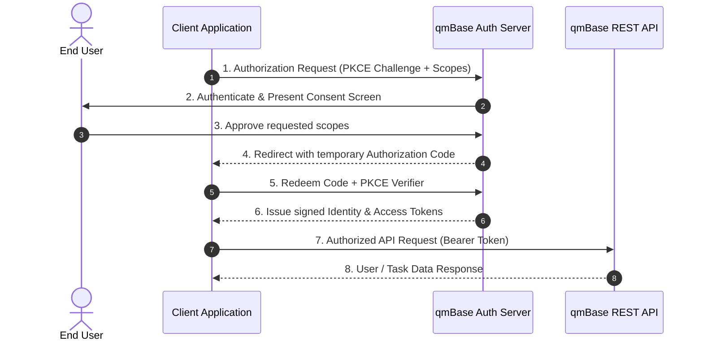

🚀 Neues Update verfügbar! Wir haben unser System für Sie weiter optimiert: Freuen Sie sich auf ... noch komfortableres Arbeiten.
{/* truncate */}

## General

### 🚀 Release Notes: Public REST API & OAuth 2.0 Authorization Server (Private Preview)

We are thrilled to announce one of our most anticipated additions to the platform: the **qmBase Public REST API**, powered by a brand-new, enterprise-grade **OAuth 2.0 & OpenID Connect (OIDC) Authorization Server**.

Starting today, this capability is rolling out in **Private Preview**. It allows developers and partners to securely integrate third-party applications, automate workflows, and interact with qmBase programmatically—without ever sharing user passwords or compromising tenant boundaries.

---

#### ✨ Key Highlights

- **Modern, Standards-Compliant Authentication**: Built on industry-standard OAuth 2.0 and OpenID Connect protocols.
- **PKCE-Enforced Authorization Code Flow**: Implements the recommended Authorization Code flow with mandatory SHA-256 code challenge (PKCE) for robust, modern application security.
- **Isolated Security Boundary**: Client registrations, grants, and token lifecycles are persisted in a dedicated authorization database, completely isolated from tenant business data.
- **Transparent User Consent**: Users authenticate via their familiar qmBase login experience and explicitly review what requesting client applications can access before granting permissions.
- **Initial API Coverage**: First-class REST endpoints for **User Management** and **Task Management**, with more endpoints arriving in upcoming releases.

---

#### 🔒 Enterprise-Grade Security Architecture

Our new authorization server delivers the highest security standard for API integrations:

- **Authorization Code Flow with PKCE (`S256`)**: Follows OAuth 2.0 best practices to prevent code interception and replay attacks across web, mobile, and desktop applications.
- **Single-Use, Short-Lived Codes**: Authorization codes expire after 5 minutes and can be redeemed exactly once.
- **Automated OIDC Discovery**: Standard discovery document (`/.well-known/openid-configuration`) and published JSON Web Key Sets (JWKS) enable clients to automatically discover endpoints and verify cryptographic token signatures.
- **Seamless Key Rotation**: Automated key publication ensures uninterrupted token verification during cryptographic key lifecycle updates.
- **Strict Client Validation**: Enforces exact redirect URI matching and validates client credentials before issuing tokens.

---

#### 📦 What’s in the Private Preview?

The Public REST API launches with support for foundational workflows, with expanded endpoint coverage planned in future releases:

| Resource Domain        | Supported Capabilities                                                              |
| :--------------------- | :---------------------------------------------------------------------------------- |
| **👥 User Management** | Query and manage user directory records, profile details, and account associations. |
| **✅ Task Management** | Retrieve, assign, and update task workflows and status tracking across projects.    |

---

#### 🔄 How the Flow Works

---

#### 🎟️ How to Get Early Access

During the Private Preview period, access is available by request to ensure hands-on developer support and collect early feedback.

- **Interested in building an integration?**  
  Contact our developer support team at [**support@qmbase.com**](mailto:support@qmbase.com) with:
  1. Your organization and use case.
  2. The client application type (Web app, native app, CLI/service).
  3. Desired redirect URIs and scopes.

We will register your client credentials, provide you with API documentation, and help you get up and running!
