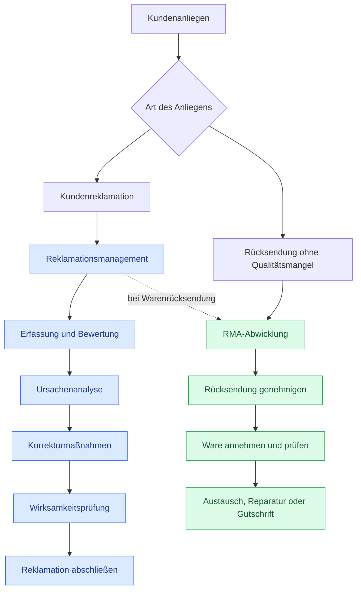
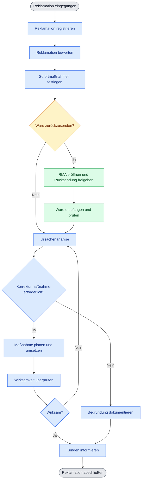

- Kundendaten können synchronisiert werden, um eine nahtlose Bearbeitung von Reklamationen und RMA-Prozessen zu gewährleisten.
- Auftragsdaten: Reicht eine Auftragsnummer? Muss alles per Hand ausgefüllt werden?
- Wareneingang: Verknüpfung mit Artikeln und Menge?
- Was muss die Reklamationsbearbeitung über RMAs wissen?
- Bulk editing for RMA Article Entries
- Action Buttons for connections
- Gerechtfertigt mit aufnehmen
- Freitextfelder für zusätzliche Kunden und Artikel

## 1. Abgrenzung: RMA vs. Reklamationsmanagement

## 2. Prozessablauf einer Kundenreklamation mit optionaler RMA

